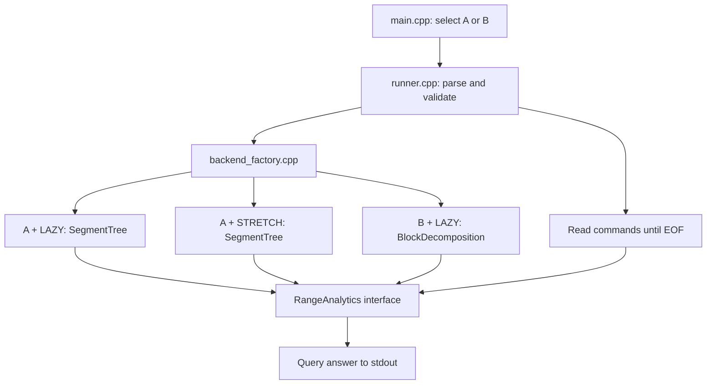

# CS 203D - Project 3: Range Analytics on Sensor Streams

**Team name:** IDK
**Repository:** CS203d-IDK-p3

## Team members

| Roll number | Name | GitHub username | Role | Analysis question |
|---|---|---|---|---|
| 250051013 | Khairnar Soham Nilesh | Soham-Khairnar | Structure A owner (segment tree) | Q1 |
| 250008035 | Smita Singh | smitasingh25 | Structure B owner (block decomposition) | Q2 |
| 250051002 | Abhishek Verma | warrior5301 | Application owner | Q3 |
| 250008033 | Shrawan Kumar Prajapati| shrawanprajapati| Test owner (also builds worst-case inputs) | Q4 |
| [roll no.] | [name] | [username] | Measurement owner | Q5 |

## Current status

The application owner's CLI, input validation, shared interface, dispatch, examples,
and Q3 answer are implemented. Structure B's LAZY block decomposition and its unit
tests are implemented. Structure A remains an unimplemented scaffold, so the
production segment tree and STRETCH route are not ready for end-to-end use. There is
no production array fallback.

## Requirements

- C++17; verified locally with MinGW GCC 6.3.0 on Windows.
- Python 3 for build, launcher, and test scripts; standard library only.
- `g++` on PATH, or set `CXX` to a compiler executable path compatible with GCC flags.
- Scripts handle Windows and Unix executable names; Linux/macOS are not yet verified.

## Build, run, test, benchmark

Run from the repository root:

```text
python build.py
python run.py --structure A --input tests/examples/lazy.in
python tests/run_tests.py
python bench/benchmark.py
```

The run command currently reports the missing Structure A implementation. The
benchmark command exits with a not-implemented message. Neither is a successful
end-to-end project run yet.

After the structures are implemented, equivalent direct examiner commands are:

```text
# Windows Command Prompt
build\run.exe --structure A < tests\examples\lazy.in
build\run.exe --structure B < tests\examples\lazy.in

# Linux/macOS shell
./build/run --structure A < tests/examples/lazy.in
./build/run --structure B < tests/examples/lazy.in
```

In PowerShell use `python run.py --structure A --input ...`. Omit `--input` to read
standard input. The C++ executable accepts `--help`. Exit codes: 0 for success/help,
1 for input/backend errors, 2 for invalid C++ CLI arguments. Errors go to stderr.
Only query answers go to stdout, one integer per line; updates print nothing.
Processing stops at the first error; any answers already printed remain in stdout.

## Input contract

Line 1 is `LAZY n` or `STRETCH n`, with `1 <= n <= 1000000`. Line 2 contains
exactly n signed 64-bit readings. Commands follow until EOF. Blank command lines
are allowed. Comments, extra tokens, and unknown commands are rejected.

All indices are **1-based** and ranges **inclusive**, with `1 <= l <= r <= n`.

| Command | Action | LAZY: A/B | STRETCH: A |
|---|---|---|---|
| `U i v` | Assign a[i] = v | Yes | Yes |
| `A l r x` | Add x to a[l..r] | Yes | No |
| `S l r` | Print sum | Yes | Yes |
| `M l r` | Print minimum | Yes | No |
| `B l r` | Print best nonempty contiguous stretch sum | No | Yes |

Structure B rejects STRETCH mode. An all-negative best stretch returns the largest
reading, not zero. Use inputs whose values, intermediate arithmetic and results fit
signed 64-bit integers; no overflow policy is defined by the brief.

Example input (`tests/examples/lazy.in`):

```text
LAZY 5
1 2 3 4 5
S 1 5
A 2 4 10
M 1 5
U 1 -5
S 1 3
```

Expected output once either LAZY backend is implemented:

```text
15
1
20
```

`tests/examples/stretch.in` and `.out` provide the Structure A STRETCH example.

## Application architecture



`src/range_analytics.hpp` is the integration contract. Backends receive initial
readings as a normal zero-offset vector, but all public operation indices are
1-based. They return values without printing. The runner validates complete commands
before invoking them and streams commands instead of storing the entire workload.
Tests inject a backend through `BackendFactory`; production uses `makeBackend`.

## Ownership and remaining work

| Location | Owner / next work |
|---|---|
| `app/`, interface, factory, build/launcher scripts | Abhishek: implemented; integrate completed backends |
| `src/structA/` | Soham: LAZY/STRETCH segment tree and unit tests; see local README |
| `src/structB/` | Smita Singh: completed LAZY block decomposition, unit tests and Q2; see local README |
| `tests/` | Test owner: full oracle, differential tests, invariants, worst-case inputs |
| `bench/`, `results/` | Measurement owner: timings, memory, CSV and figures |
| `REPORT.md` | Each member: complete assigned sections and analysis answer |

## Known limitations

- Both production backends are placeholders; production query files cannot yet run.
- Application tests do not verify data-structure correctness or complexity.
- Full differential/invariant tests, benchmarks, results, report export, and slides
  remain pending. No performance claims or measurements are available.
- Two team-member entries still need actual names, roll numbers and usernames.
- The application is a CLI; no React dashboard is included.
